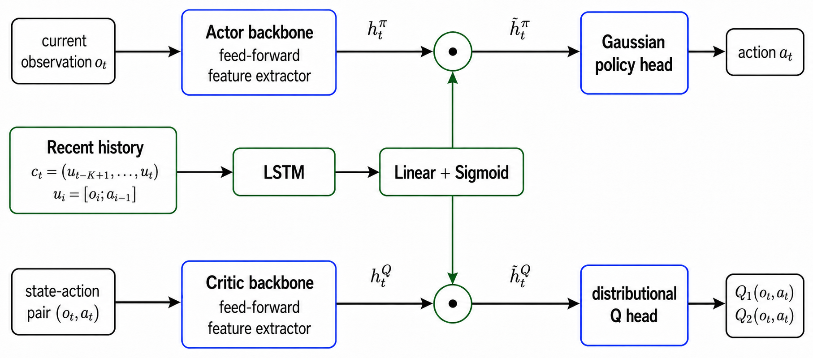
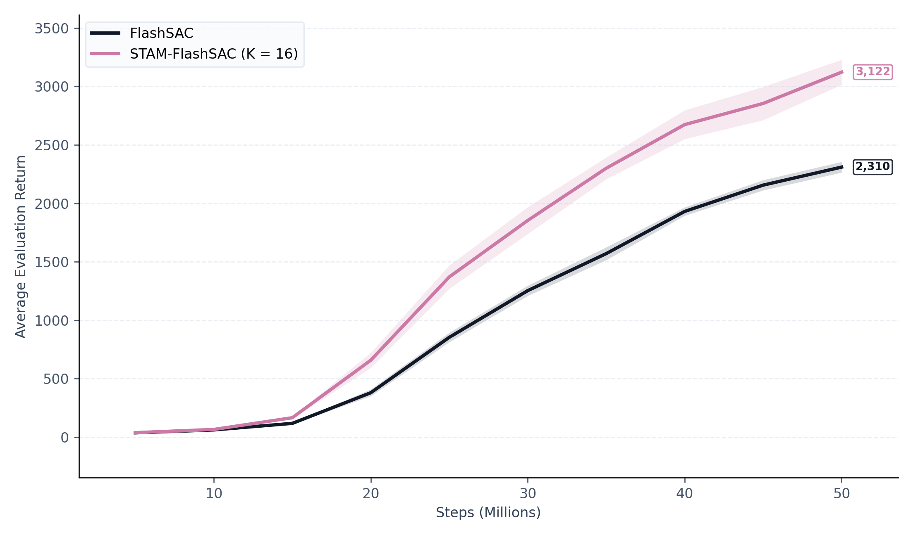
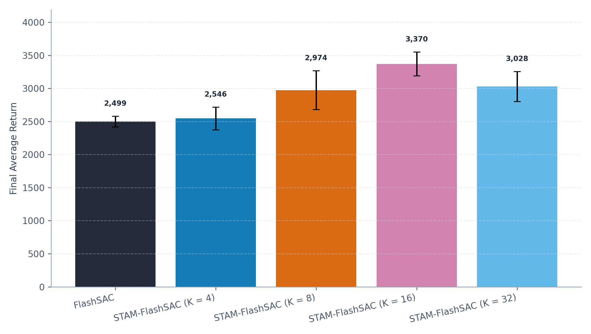
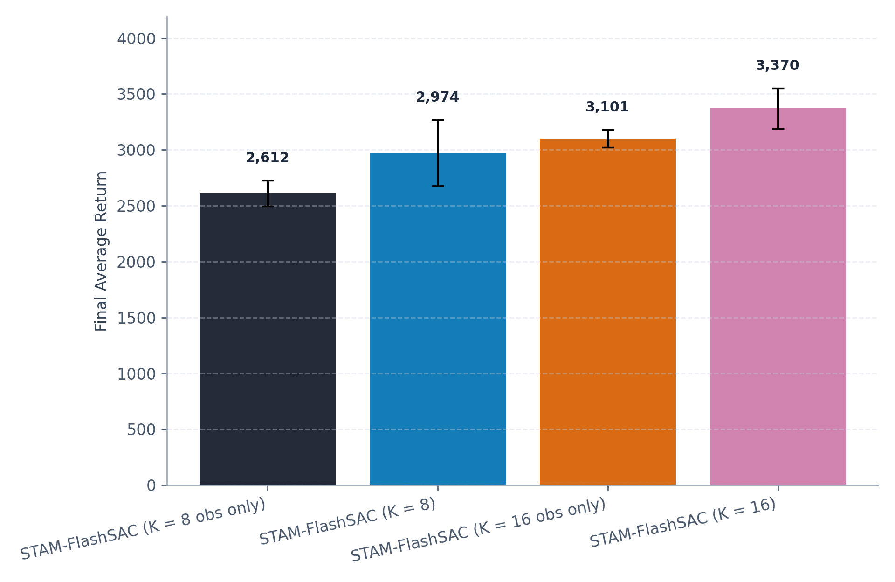

<div align="center">

# STAM-FlashSAC

### Short-Term Action-Observation Memory for FlashSAC in Dexterous Manipulation

Zheng-Lin Wu, Jian-Bin Wu, Chih-En Kuo, I-Chen Lee, Yu-Lin Chu

National Taiwan University

**Oral presentation, NTU Fall 2026 ML-MiniConf**

[](docs/STAM-FlashSAC.pdf)
[](docs/STAM-FlashSAC_slides.pdf)
[](LICENSE)

</div>

STAM-FlashSAC adds a lightweight recurrent memory branch to [FlashSAC](https://github.com/Holiday-Robot/FlashSAC), a high-throughput off-policy actor-critic. An LSTM encodes the last *K* observation–action pairs, and its output **gates** the actor and critic features, so the feed-forward FlashSAC backbone stays unchanged.

On the IsaacLab Shadow Hand cube reorientation task, STAM-FlashSAC improves the final evaluation return over FlashSAC by **35.5%** (2,310 → 3,122) within a 50M-step budget, and **all 10 paired seeds improve**.

<p align="center">
  
</p>

## Highlights

- **+35.5% final return** over FlashSAC on `Isaac-Repose-Cube-Shadow-OpenAI-FF-Direct-v0` (10 paired seeds; paired bootstrap 95% CI of the gain [594.6, 999.5]; exact sign-flip test *p* = 0.002).
- **Plug-in design.** STAM only re-weights hidden features through a sigmoid gate, so the FlashSAC backbone and losses are unchanged; the replay buffer stores the matching context windows so acting and learning see identical histories.
- **Memory, not just more input.** STAM beats *K* = 16 frame-stacking baselines while using fewer parameters (2.75M vs. 2.87M / 3.08M).
- **Ablations** over context length, action history, LSTM hidden size, encoder type (LSTM / GRU / MLP), and actor/critic placement are in the [paper](docs/STAM-FlashSAC.pdf).

## Results

All runs use 50M environment steps on Shadow Hand OpenAI-FF cube reorientation; evaluation returns are averaged over 1,024 episodes with a deterministic policy.

<p align="center">
  
</p>

**Main comparison (10 paired seeds)**

| Method | Final return | Gain |
|---|---:|---:|
| FlashSAC | 2,310 | – |
| STAM-FlashSAC (*K* = 16) | **3,122** | **+35.5%** |

**Comparison with frame stacking (5 seeds)**

| Method | Params | Final return | Gain |
|---|---:|---:|---:|
| FlashSAC | 2.47M | 2,352 | – |
| FrameStack (*K* = 16, obs + action) | 3.08M | 2,881 | +22.5% |
| FrameStack (*K* = 16, obs only) | 2.87M | 3,229 | +37.3% |
| STAM-FlashSAC (*K* = 16) | 2.75M | **3,409** | **+45.0%** |

**Ablations (3 seeds).** *K* = 16 gives the best return among *K* ∈ {4, 8, 16, 32}, and including previous actions in the memory beats observation-only memory at both *K* = 8 and *K* = 16.

<p align="center">
  
  
</p>

## Repository Layout

```text
STAM-FlashSAC/
├── stam_flashsac/               # package code
│   ├── flashsac/                # FlashSAC-style models, agent, buffer, runtime helpers
│   ├── stam.py                  # STAM memory gate
│   ├── training.py              # training entrypoint
│   ├── experiment_runner.py     # multi-run launcher
│   ├── plotting.py              # result plotting
│   └── results.py               # lightweight result export helpers
├── scripts/                     # CLI entrypoints
├── configs/                     # default experiment configuration
├── docs/                        # paper, slides, and README figures
├── results/                     # generated by runs, gitignored
├── checkpoints/                 # local training checkpoints, gitignored
├── pyproject.toml
├── uv.lock
└── README.md
```

Runs write their results by environment, variant, n-step setting, and seed, for example:

```text
results/experiment/Isaac-Repose-Cube-Shadow-OpenAI-FF-Direct-v0/memory_k16_action_nstep3/seed0/training_log.csv
```

## Environment

This repository uses `uv` and the IsaacLab-compatible dependency set inherited from FlashSAC.

```bash
cd STAM-FlashSAC
uv sync --extra isaaclab
```

Quick import check:

```bash
uv run python -c "import torch; print(torch.__version__)"
uv run python -c "import isaaclab; print('isaaclab ok')"
```

## Run Experiments

Dry-run the full suite:

```bash
uv run python scripts/run_experiments.py --suite all --dry-run
```

Run the main comparison:

```bash
uv run python scripts/run_experiments.py --suite main --gpus 0,1 --processes-per-gpu 1
```

Useful options:

```text
--suite main | ablations | all
--variants baseline,memory_k16_action
--seeds 0,1,2,3,4
--gpus 0,1
--processes-per-gpu 1
--n-step 3
--stam-context-len 16
--result-mode append | overwrite
--result-set my_run
--wandb
--wandb-project STAM-FlashSAC
--wandb-mode online | offline
```

Suites:

- `main`: runs the primary comparison, `baseline` and `memory_k16_action`.
- `ablations`: runs memory/action ablations, `memory_k4_action`, `memory_k8_action`, `memory_k16_action`, `memory_k8_obs`, and `memory_k16_obs`.
- `all`: runs every configured variant from `main` and `ablations`.

`append` is the default. It keeps existing `results/experiment/<env_name>/<variant>_nstepN/seedX` data and writes repeated runs under a result-set subfolder. `overwrite` replaces the existing data for a previously run seed/result-set.
Results are grouped by environment first, so different tasks can coexist under `results/experiment/<env_name>/...`.

## Weights & Biases Logging

TensorBoard logging is always written under each run's `tensorboard/` directory. To also stream scalar metrics and the run config to Weights & Biases, first log in:

```bash
wandb login
```

For a single training run:

```bash
uv run python scripts/train.py \
  --wandb \
  --wandb-project STAM-FlashSAC \
  --output-root checkpoints/single_run
```

For the experiment runner:

```bash
uv run python scripts/run_experiments.py \
  --suite main \
  --gpus 0,1 \
  --processes-per-gpu 1 \
  --wandb \
  --wandb-project STAM-FlashSAC
```

On machines without stable network access, log locally and sync later:

```bash
uv run python scripts/run_experiments.py \
  --suite main \
  --result-set main_run \
  --wandb \
  --wandb-mode offline

wandb sync checkpoints/main_run/wandb
```

Useful W&B options:

```text
--wandb | --no-wandb
--wandb-project STAM-FlashSAC
--wandb-entity <team-or-user>
--wandb-mode online | offline
```

W&B records scalar metrics and config values only. Controller checkpoints, replay buffers, and other large artifacts remain local unless they are uploaded separately.

## Record MP4 Rollouts

Trained IsaacLab policies can be recorded as MP4 videos from an existing checkpoint run directory. The experiment runner writes each run to `checkpoints/<result_set>/<env_id>_<variant>_seed<N>/`, where `<result_set>` is the `--result-set` value (a timestamp if omitted); the examples below assume `--result-set main_run`. The recorder uses IsaacLab's `render_mode="rgb_array"` path with headless offscreen video rendering, so run it on a machine with IsaacLab/Isaac Sim and an NVIDIA GPU available.

For a quick short test:

```bash
CUDA_VISIBLE_DEVICES=3 uv run python scripts/record_mp4.py \
  --run-dir checkpoints/main_run/Isaac-Lift-Cube-Franka-v0_memory_k16_action_seed0 \
  --checkpoint best \
  --out checkpoints/main_run/Isaac-Lift-Cube-Franka-v0_memory_k16_action_seed0/test.mp4 \
  --device cuda:0 \
  --steps 80 \
  --frame-stride 2 \
  --width 1280 \
  --height 720 \
  --fps 30
```

For a full rollout:

```bash
CUDA_VISIBLE_DEVICES=3 uv run python scripts/record_mp4.py \
  --run-dir checkpoints/main_run/Isaac-Lift-Cube-Franka-v0_memory_k16_action_seed0 \
  --checkpoint best \
  --out checkpoints/main_run/Isaac-Lift-Cube-Franka-v0_memory_k16_action_seed0/rollout.mp4 \
  --device cuda:0 \
  --steps 250 \
  --frame-stride 2 \
  --width 1280 \
  --height 720 \
  --fps 30
```

Useful MP4 options:

```text
--checkpoint best | latest | /path/to/controller.pt
--seed 42
--camera-eye 1.7 1.2 0.9
--camera-lookat 0.5 0.0 0.15
--rendering-mode performance | balanced | quality
--action-scale 2.75
```

`CUDA_VISIBLE_DEVICES=3 --device cuda:0` means the process sees physical GPU 3 as local `cuda:0`. The default output is `<run-dir>/rollout.mp4`. The recorder uses deterministic policy actions by default; `--action-scale` only overrides the environment action scaling used during recording. For `Isaac-Lift-Cube-Franka-v0`, the training wrapper scale is `3.0`, so lowering it too much can make the policy fail to lift the cube.

## Plot Results

```bash
uv run python scripts/plot_results.py
```

If you have multiple environments under `results/experiment/`, you can select which one to plot:

```bash
uv run python scripts/plot_results.py --figure-dataset paper_main --figure-env Isaac-Repose-Cube-Shadow-OpenAI-FF-Direct-v0
```

Plots are written to:

```text
results/figures/
```

`results/figures/` is intentionally reserved for the current plotted experiment. Results may contain multiple n-step settings, but the default figures use the paper setting, `n_step=3`, and therefore omit `n-step=3` from legend labels.

Summaries are written to:

```text
results/summaries/
```

Raw training logs, checkpoints, replay buffers, and TensorBoard event files are not included in this repository; the figures used in this README are in `docs/assets/`. To rebuild the result layout from local experiment folders:

```bash
uv run python scripts/migrate_historical_results.py \
  --nstep1-archive-dir /path/to/nstep1/archive \
  --paper-main-dir /path/to/paper/main
```

## Citation

```bibtex
@inproceedings{wu2026stam,
  title     = {Short-Term Action-Observation Memory for FlashSAC in Dexterous Manipulation},
  author    = {Wu, Zheng-Lin and Wu, Jian-Bin and Kuo, Chih-En and Lee, I-Chen and Chu, Yu-Lin},
  booktitle = {National Taiwan University Fall 2026 ML-MiniConf},
  note      = {Oral presentation},
  year      = {2026}
}
```

## License

This repository is released under the MIT License. The minimal IsaacLab wrapper vendored under `stam_flashsac/vendor/flash_rl` follows the FlashSAC license included in that folder.

## Acknowledgements

This project was developed as the final project of the Deep Reinforcement Learning course (Spring 2026) at National Taiwan University. It builds on [FlashSAC](https://github.com/Holiday-Robot/FlashSAC) and uses a minimal vendored IsaacLab environment wrapper derived from the FlashSAC codebase.

FlashSAC:

```bibtex
@article{kim2026flashsac,
  title={FlashSAC: Fast and Stable Off-Policy Reinforcement Learning for High-Dimensional Robot Control},
  author={Kim, Donghu and Lee, Youngdo and Park, Minho and Kim, Kinam and Nahendra, I Made Aswin and Seno, Takuma and Min, Sehee and Palenicek, Daniel and Vogt, Florian and Kragic, Danica and Peters, Jan and Choo, Jaegul and Lee, Hojoon},
  journal={arXiv preprint arXiv:2604.04539},
  year={2026}
}
```
